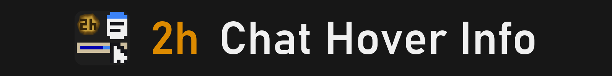
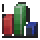
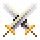
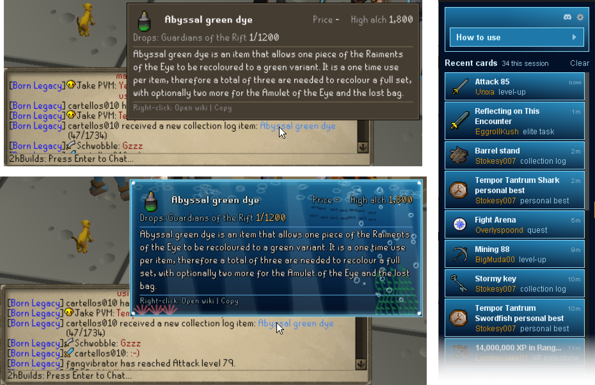
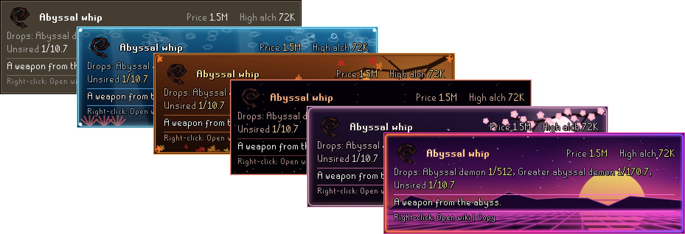

Hover a name in your chat for a card about it. 
Prices, drop rates, unlocks, boss stats and the wiki's first paragraph, with the full page one click away.

## Quick guide

1. **Hover** a coloured name in a broadcast.
2. **Right-click** the line to open the wiki or copy the name.
3. **Pick a theme** in the settings menu (the settings icon on the sidebar).
4. **Missed one?** Every card this session waits in the sidebar.

<table width="100%">
<tr>
<td width="48" valign="top"></td>
<td valign="top"><b>Drops & pets</b> Price, alch value, drop rate.</td>
<td width="48" valign="top"></td>
<td valign="top"><b>Quests, tasks, diaries</b> Difficulty, points, what it asks.</td>
<td width="48" valign="top"></td>
<td valign="top"><b>Level-ups</b> Everything the level unlocks.</td>
</tr>
<tr>
<td width="48" valign="top"></td>
<td valign="top"><b>Bosses</b> Picture, stats, kill counts, PBs.</td>
<td width="48" valign="top"></td>
<td valign="top"><b>Examine</b> Any item or monster.</td>
<td width="48" valign="top"></td>
<td valign="top"><b>24 themes</b> For the card and the sidebar.</td>
</tr>
</table>

 

 

Classic · Ocean · Autumn · Black hole · Sakura · Synthwave, and 18 more.

## Good to know

- **It never reads what players type.** Only the game's broadcasts, your own drop, level and examine lines, and RuneLite's kill count and personal best answers.
- **What it asks for.** With "Wiki text" on, a card's page name is sent to the Old School RuneScape Wiki for its first paragraph. With "Wiki pictures" on, the same name is sent for a boss, monster or chest picture. Nothing about you, ever. Turn both off and nothing is sent.
- **The data.** Quests, tasks, pets, diaries, level unlocks, drop rates and boss stats are bundled from the <a href="https://oldschool.runescape.wiki">Old School RuneScape Wiki</a> (CC BY-NC-SA 3.0), as are the paragraphs and pictures. Prices come from RuneLite.

---

<strong>Found a bug or have an idea?</strong> Join the <a href="https://discord.gg/nsam4CfWzf">2hBuilds Discord</a>.

Want every setting and rule explained? Read the <a href="https://github.com/2hBuilds/chat-hover-info/blob/main/DETAILS.md">full details</a>.
