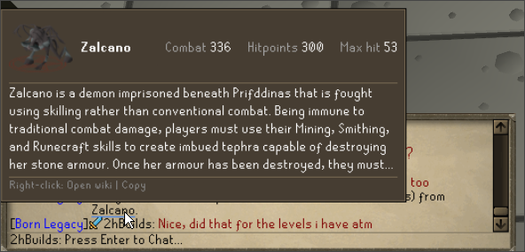
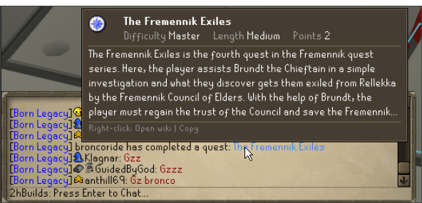
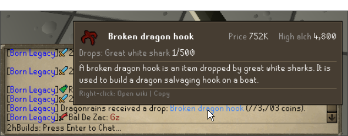
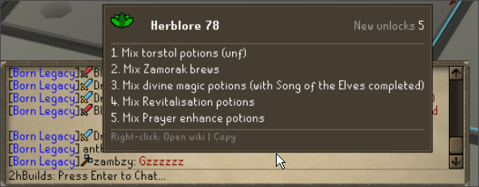

- Hover a name in your chat for a card about it. 
- Prices, drop rates, unlocks, boss stats and the wiki's first paragraph, with the full page one click away.

<table width="100%">
<tr>
<td align="center" valign="top" width="50%">

 
**Bosses** · the wiki's picture and stats

</td>
<td align="center" valign="top" width="50%">

 
**Quests** · difficulty, length and points

</td>
</tr>
<tr>
<td align="center" valign="top" width="50%">

 
**Drops** · price, alch value and drop rate

</td>
<td align="center" valign="top" width="50%">

 
**Levels** · everything you just unlocked

</td>
</tr>
</table>

## What it shows

- **Drops.** Yours, a clanmate's or a friend's: price, alch value, where it drops and how rarely, then the wiki's first paragraph. See just how lucky they got.
- **Bosses, monsters and chests.** When a drop line names its source, the source gets a card: the wiki's picture and, for a boss, combat level, hitpoints, max hit and quest, then the first paragraph.
- **Quests, combat tasks, diaries.** A quest's difficulty, length and points; a task's tier, points, boss and what it asks; a diary's tier.
- **Pets.** Where it comes from, its drop rate and the kill count it dropped at.
- **Levels.** What a new level unlocks, from the wiki's level-up tables. XP milestones too.
- **Kill counts and personal bests.** The game's own, and the answers to a clan member's `!kc` and `!pb`, with the boss's picture and stats.

## Quick guide

1. **Hover.** Rest the mouse on an item, quest, task, pet or boss name in a broadcast. Hoverable names are blue. Level lines and boss names underline under the mouse.
2. **Open the wiki.** Right-click the line, then "Open wiki", or "Copy" for the name.
3. **Place the card.** Above the cursor, or wide and pinned above the chatbox ("Card place"). "Card width" sets how wide it grows.
4. **Show it your way.** On hover, while a key is held, or on click, with a delay and your own text size.
5. **Quiet it down.** Switch off the blue words, wiki paragraphs, pictures or boss cards, and pick your two colours, in the settings menu (the settings icon on the sidebar panel).
6. **Read in peace.** If a new line shifts the chat, the card stays until you move the mouse or turn the wheel.

## Good to know

- **It never reads what players type.** Only the game's broadcasts, your own drop lines, and RuneLite's own kill count and personal best answers.
- **What it asks for.** With "Wiki descriptions" on, a card's wiki page name is sent to the Old School RuneScape Wiki for that page's first paragraph. With "Wiki pictures" on, the same name is sent for a boss, monster or chest picture, which is then fetched from the wiki. Nothing about you, ever. Turn the switches off and nothing is sent.
- **The data.** Quests, tasks, pets, diaries, level unlocks, drop rates and boss stats are bundled from the <a href="https://oldschool.runescape.wiki">Old School RuneScape Wiki</a> (CC BY-NC-SA 3.0), as are the paragraphs and pictures. Prices come from RuneLite.
- **Something wrong?** Tell us in the 2hBuilds Discord - the link is in the settings menu.

---

<strong>Found a bug or have an idea?</strong> Join the <a href="https://discord.gg/nsam4CfWzf">2hBuilds Discord</a>.

Want every setting and rule explained? Read the <a href="https://github.com/2hBuilds/chat-hover-info/blob/main/DETAILS.md">full details</a>.
